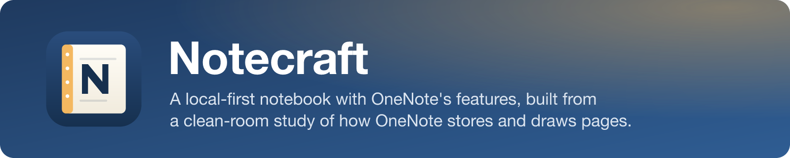
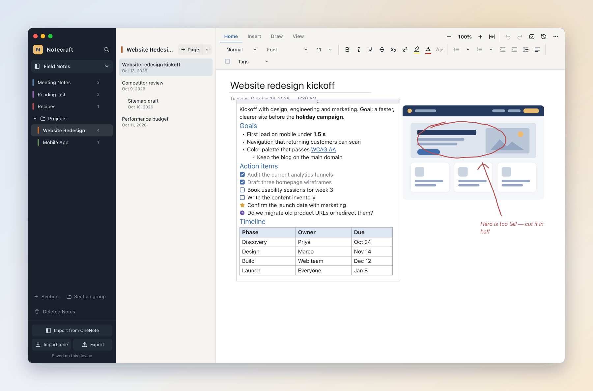
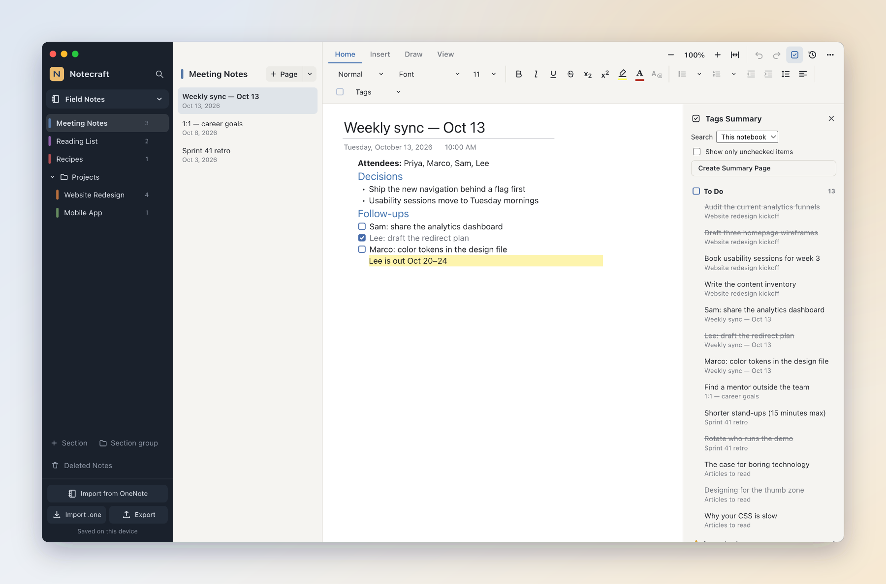
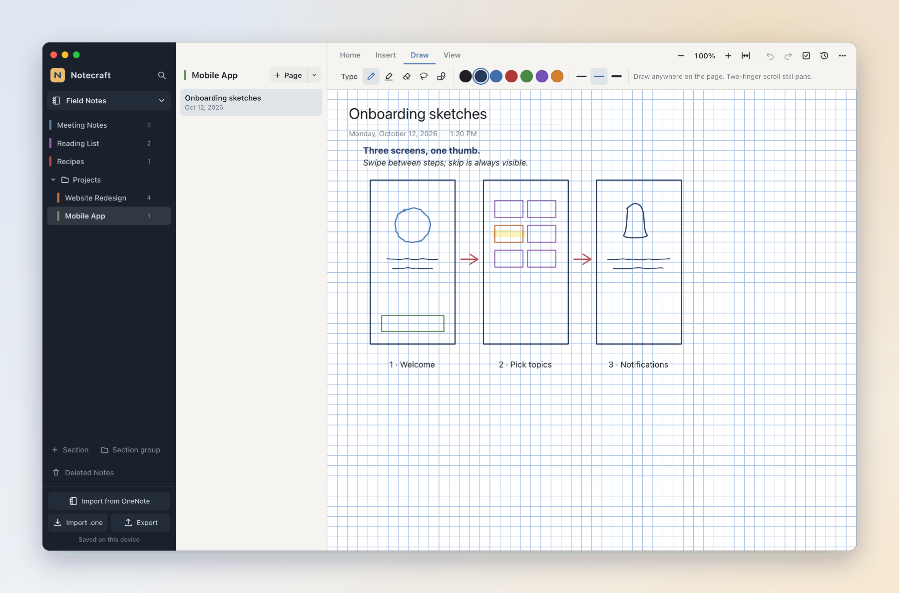
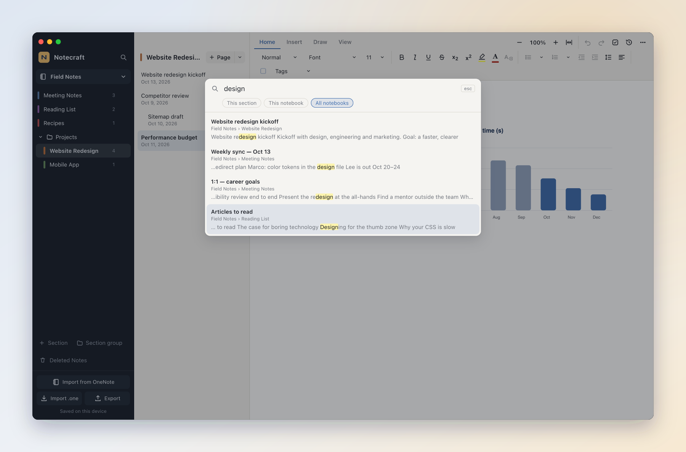
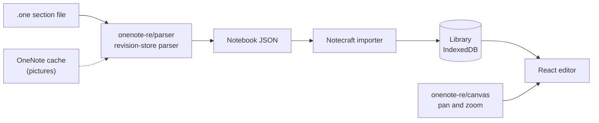

<p align="center">
  
</p>

<p align="center">
  <a href="https://github.com/joshmaster2165/Notecraft/releases/latest"></a>
  <a href="https://github.com/joshmaster2165/Notecraft/actions/workflows/ci.yml"></a>
  
  <a href="notecraft/docs/PARITY.md"></a>
</p>

<p align="center">
  <a href="#download"><b>Download</b></a> ·
  <a href="#features"><b>Features</b></a> ·
  <a href="#import-your-onenote-notebooks"><b>Import from OneNote</b></a> ·
  <a href="#how-its-built"><b>How it's built</b></a> ·
  <a href="notecraft/docs/PARITY.md"><b>Parity checklist</b></a>
</p>

<picture>
  <source media="(prefers-color-scheme: dark)" srcset="docs/images/hero-dark.png">
  
</picture>

Notecraft is a free-form notebook in the spirit of OneNote: click anywhere on
the page to write, mix text, tables, pictures and ink, and organize it all in
notebooks, sections and pages. Your notes stay on your device.

What sets it apart is where its behaviour comes from. Instead of guessing,
Notecraft follows a clean-room study of OneNote for Mac: how it lays out its
`.one` files on disk, and how its page canvas pans and zooms. That research
lives in this repository too, and it's what lets Notecraft **open your
OneNote notebooks, including their page history**.

## Download

| Platform | Installer |
|---|---|
| macOS, Apple Silicon | [`Notecraft-…-mac-arm64.dmg`](https://github.com/joshmaster2165/Notecraft/releases/latest) |
| macOS, Intel | [`Notecraft-…-mac-x64.dmg`](https://github.com/joshmaster2165/Notecraft/releases/latest) |
| Windows | [`Notecraft-…-win-x64.exe`](https://github.com/joshmaster2165/Notecraft/releases/latest) (ARM64 build also available) |
| Linux | [`.AppImage` or `.deb`](https://github.com/joshmaster2165/Notecraft/releases/latest) |

> [!NOTE]
> The macOS app isn't notarized yet. The first time, right-click Notecraft in
> Applications and choose **Open**, or run
> `xattr -dr com.apple.quarantine /Applications/Notecraft.app`.

Prefer the browser? `cd notecraft && npm install && npm run dev` runs the same
app at `http://127.0.0.1:5190`.

## Features

<table>
<tr>
<td width="50%" valign="top">

**Write anywhere on the page.** Containers you can drag and resize, rich text,
headings, Citation and Code styles, paragraph and line spacing, bullet and
numbering libraries, tables with shading and sorting, pictures with alt text
and rotation, file attachments and audio recordings.

**Paste that keeps its shape.** Text from the web or Word keeps its bold,
italics, links, colors, headings and nested lists. <kbd>⌥⇧⌘V</kbd> pastes
plain text.

**Organize like OneNote.** Notebooks, color-coded sections, nested section
groups, three levels of subpages, page templates, move and copy, and Deleted
Notes for 60 days.

</td>
<td width="50%" valign="top">

**Tags and to-dos.** All 29 of OneNote's tags with <kbd>⌘1</kbd>–<kbd>⌘9</kbd>,
your own custom tags, and **Find Tags** across a section, a notebook or
everything, with a one-click **Tags Summary page**.

**Links everywhere.** Link to a page, a section or a single paragraph, or type
`[[Page title]]` to link (and create) pages as you write.

**Page versions.** Notecraft keeps snapshots as you work; preview any version
and restore it in one step. OneNote's own history comes along on import.

</td>
</tr>
</table>

<table>
<tr>
<td width="50%"></td>
<td width="50%"></td>
</tr>
<tr>
<td><b>Find Tags.</b> Every tagged note in one list, grouped by tag; check items off where they live.</td>
<td><b>Draw.</b> Pen, highlighter, shapes, lasso select and eraser, on plain, ruled or grid paper. Ink is stored in page points, so it stays on its text at every zoom.</td>
</tr>
<tr>
<td width="50%"></td>
<td width="50%" valign="top">

**Search** titles, text, table cells and the text OneNote recognized in
pictures, in this section, this notebook or all of them.

**A canvas that feels right.** Pinch and <kbd>⌃</kbd>-scroll zoom use
OneNote's own increments and limits (25–500%), and each page reopens where
you left it.

**Desktop app** for macOS, Windows and Linux with native menus, plus print
and export to PDF, Markdown or a portable `.notecraft.json`.

</td>
</tr>
</table>

The feature-by-feature comparison with OneNote, including what's still
missing, is in **[PARITY.md](notecraft/docs/PARITY.md)**: 54 of 67 features
done, 5 partial.

## Import your OneNote notebooks

- **Desktop app:** **File › Import from OneNote on This Computer** finds the
  notebooks OneNote keeps on your machine and imports them, with page history
  and any pictures in OneNote's local cache.
- **Any version:** drop `.one` section files onto the sidebar, in the desktop
  app or the browser.

Parsing happens on your machine; nothing is uploaded. Tags (including your
custom ones), tables, pictures, links, alignment, spacing and fonts come
across. Password-protected sections and OneNote's ink are detected but not yet
decoded.

## How it's built



| Folder | What's inside |
|---|---|
| [`notecraft/`](notecraft/) | The app: React 19, Vite and Electron. Its README maps each feature to the OneNote structure it follows. |
| [`onenote-re/`](onenote-re/) | The research: a TypeScript parser for `.one` files, the reconstructed pan and zoom canvas, and notes on [the file format](onenote-re/docs/file-format.md) and [the canvas](onenote-re/docs/canvas.md). |

### Develop

```bash
cd notecraft
npm install
npm run dev        # web app at http://127.0.0.1:5190
npm run desktop    # desktop app
npm test
```

Pushing a tag like `v0.3.0` builds installers for every platform and
publishes them as a GitHub Release.

## About the reverse engineering

`onenote-re` documents OneNote's on-disk format and canvas behaviour for
interoperability: reading your own notebooks in another app. Its code is
written from scratch, guided by Microsoft's published [MS-ONESTORE] and
[MS-ONE] specifications and by static analysis of OneNote for Mac 16.114.

This repository contains no Microsoft code. The raw analysis evidence
(decompiler output) stays on the analysis machine and is excluded from git;
the docs cite it by Evidence ID. Notecraft isn't affiliated with or endorsed
by Microsoft; OneNote is a trademark of Microsoft Corporation.

[MS-ONESTORE]: https://learn.microsoft.com/openspecs/office_file_formats/ms-onestore/
[MS-ONE]: https://learn.microsoft.com/openspecs/office_file_formats/ms-one/
