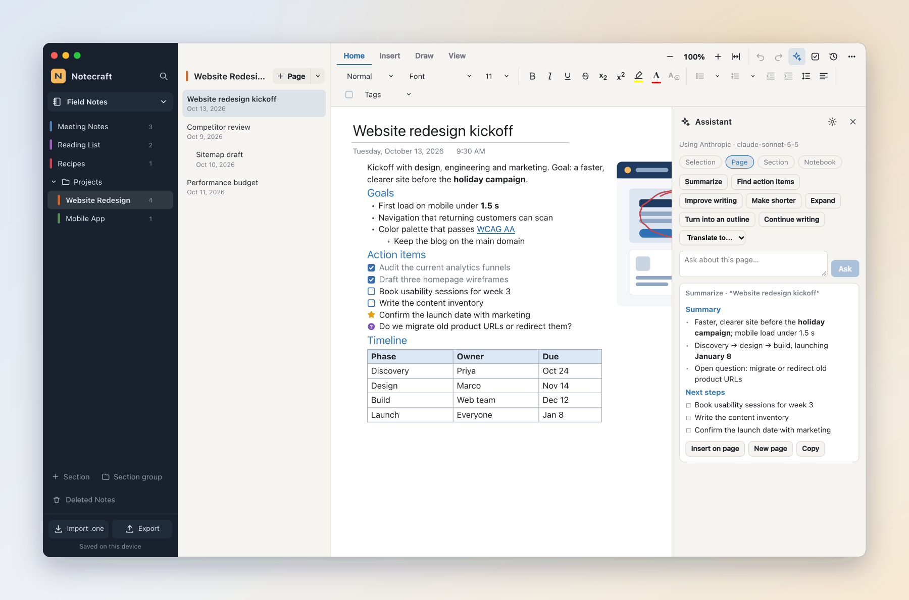
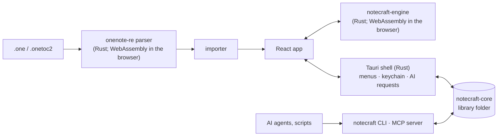

<p align="center">
  
</p>

<p align="center">
  <a href="https://github.com/joshmaster2165/Notecraft/releases/latest"></a>
  <a href="https://github.com/joshmaster2165/Notecraft/actions/workflows/ci.yml"></a>
  
  
  <a href="notecraft/docs/PARITY.md"></a>
</p>

<p align="center">
  <a href="#download"><b>Download</b></a> ·
  <a href="#features"><b>Features</b></a> ·
  <a href="#import-your-onenote-notebooks"><b>Import from OneNote</b></a> ·
  <a href="#ai-and-agents"><b>AI &amp; agents</b></a> ·
  <a href="#how-its-built"><b>How it's built</b></a> ·
  <a href="notecraft/docs/PARITY.md"><b>Parity checklist</b></a>
</p>

<picture>
  <source media="(prefers-color-scheme: dark)" srcset="docs/images/hero-dark.png">
  
</picture>

Notecraft is a free-form notebook in the spirit of OneNote: click anywhere on
the page to write, mix text, tables, pictures and ink, and organize it all in
notebooks, sections and pages.

- **Your notes are files you own.** The desktop app keeps your library as
  plain files in a folder on your disk: one JSON file per page, pictures and
  recordings as normal files. Back it up or sync it however you like.
- **It opens your OneNote notebooks**, including page history, ink and section
  groups, using a clean-room study of OneNote's `.one` format that lives in
  this repository, with the parser written in Rust.
- **AI on your terms.** Summaries, action items, rewriting, Ink to Text, text
  in pictures, transcription, and picture and video generation, with local
  models or your own API keys.
- **Agents can work in it.** A `notecraft` command and an MCP server let AI
  agents and scripts search, read and write your notes while you watch.

## Download

| Platform | Download |
|---|---|
| macOS, Apple Silicon | [`Notecraft_…_aarch64.dmg`](https://github.com/joshmaster2165/Notecraft/releases/latest) |
| macOS, Intel | [`Notecraft_…_x64.dmg`](https://github.com/joshmaster2165/Notecraft/releases/latest) |
| Windows | [`Notecraft_…_x64-setup.exe` or `.msi`](https://github.com/joshmaster2165/Notecraft/releases/latest) |
| Linux | [`.AppImage`, `.deb` or `.rpm`](https://github.com/joshmaster2165/Notecraft/releases/latest) |
| Command line / MCP only | [`notecraft-cli-<platform>`](https://github.com/joshmaster2165/Notecraft/releases/latest) (also inside the app) |

The app is built with Tauri, so installers are a few megabytes.

> [!NOTE]
> The macOS app isn't notarized yet. The first time, right-click Notecraft in
> Applications and choose **Open**, or run
> `xattr -dr com.apple.quarantine /Applications/Notecraft.app`.

Prefer the browser? `cd notecraft && npm install && npm run dev` runs the same
app at `http://127.0.0.1:5190`.

## Features

<table>
<tr>
<td width="50%" valign="top">

**Write anywhere on the page.** Containers you can drag and resize, rich text,
headings, Citation and Code styles, paragraph and line spacing, bullet and
numbering libraries, tables with shading and sorting, pictures with alt text,
rotation and crop, file attachments, **File Printouts** of PDFs, **equations**
(UnicodeMath or LaTeX), and audio and video recordings.

**Paste that keeps its shape.** Text from the web or Word keeps its bold,
italics, links, colors, headings and nested lists. <kbd>⌥⇧⌘V</kbd> pastes
plain text.

**Organize like OneNote.** Notebooks, color-coded sections, nested section
groups, three levels of subpages, page templates, move and copy, and Deleted
Notes for 60 days.

**Password-protected sections.** Lock a section with a password: its pages
are stored only encrypted (AES-256-GCM), and it locks itself after 10 minutes
away or with **Lock All** (<kbd>⌘⌥L</kbd>).

</td>
<td width="50%" valign="top">

**Tags and to-dos.** All 29 of OneNote's tags with <kbd>⌘1</kbd>–<kbd>⌘9</kbd>,
your own custom tags, and **Find Tags** across a section, a notebook or
everything, with a one-click **Tags Summary page**.

**Links everywhere.** Link to a page, a section or a single paragraph, or type
`[[Page title]]` to link (and create) pages as you write.

**Page versions.** Notecraft keeps snapshots as you work; preview any version
and restore it in one step. OneNote's own history comes along on import.

</td>
</tr>
</table>

<table>
<tr>
<td width="50%"></td>
<td width="50%"></td>
</tr>
<tr>
<td><b>Find Tags.</b> Every tagged note in one list, grouped by tag; check items off where they live.</td>
<td><b>Draw.</b> Pen, highlighter, shapes, <b>Ink to Shape</b>, lasso select and eraser, on plain, ruled or grid paper. Ink is stored in page points, so it stays on its text at every zoom.</td>
</tr>
<tr>
<td width="50%"></td>
<td width="50%" valign="top">

**Search** titles, text, table cells and the text OneNote recognized in
pictures, in this section, this notebook or all of them.

**A canvas that feels right.** Pinch and <kbd>⌃</kbd>-scroll zoom use
OneNote's own increments and limits (25–500%), and each page reopens where
you left it.

**Desktop app** for macOS, Windows and Linux with native menus, plus print
and export to PDF, Word (`.docx`, with real equations), OneNote (`.one`),
Markdown or a portable `.notecraft.json`.

</td>
</tr>
</table>

The feature-by-feature comparison with OneNote, including what's still
missing, is in **[PARITY.md](notecraft/docs/PARITY.md)**: 61 of 67 features
done, 2 partial.

## Import your OneNote notebooks

- **Desktop app:** **File › Import from OneNote on This Computer** finds the
  notebooks OneNote keeps on your machine and imports them, with page history
  and any pictures in OneNote's local cache.
- **Any version:** drop `.one` section files onto the sidebar, in the desktop
  app or the browser.

- **A notebook folder:** **Open OneNote notebook folder…** in the notebook
  menu, or drop the folder on the window. Section groups, order and colors come
  from its `.onetoc2` files.

Parsing happens on your machine; nothing is uploaded. Tags (including your
custom ones), tables, pictures, ink, links, alignment, spacing and fonts come
across. OneNote's password-protected sections are detected but not opened:
unlock them in OneNote, then import them again.

## AI and agents

**Settings › AI** picks a provider for each job: Ollama or LM Studio on your
own computer (free, offline, no key), OpenAI, Anthropic, Groq, Google Gemini or
any OpenAI-compatible service. Nothing is sent until you use an AI feature, and
then only to the provider you chose. The desktop app keeps API keys in your
system keychain and makes the requests from Rust, so keys never reach the page.



| | |
|---|---|
| ✨ **Assistant** | Summarize, find action items, improve, shorten, expand, outline, translate, continue, or ask a question about a selection, page, section or whole notebook; insert the answer or make it a page |
| ✍️ **Ink to Text** | Handwriting becomes typed notes in place (Draw tab) |
| 🔎 **Text in pictures** | Read the text in any picture so search finds it |
| 🎙️ **Transcribe** | Recordings become timestamped text under the recording |
| 🎨 **Generate** | Pictures and video clips from a prompt (Insert tab) |

**Agents** get a command-line tool and an MCP server, installed with the app
(Settings › Agents shows the exact paths and a ready-made MCP config):

```bash
notecraft search "launch plan"
notecraft new-page "Work/Meetings" "Standup" "- [ ] Ship it"
notecraft todos --json
claude mcp add notecraft -- notecraft mcp
```

Agents can list, search and read pages as Markdown, create and append notes,
check off to-dos, rename and delete pages (to Deleted Notes), and open a page or
a search in the Notecraft window. Their edits appear in the app within a
second.

## How it's built



| Folder | What's inside |
|---|---|
| [`notecraft/`](notecraft/) | The app: React 19 + Vite. Its README maps each feature to the OneNote structure it follows. |
| [`notecraft/src-tauri/`](notecraft/src-tauri) | The desktop shell (Tauri 2, Rust): window and menus, library folder, OneNote import, keychain, AI requests. |
| [`notecraft/crates/`](notecraft/crates) | `notecraft-core` (the library-folder format, search, editing), `notecraft` (CLI and MCP server) and `notecraft-engine` (picture crop, PDF printouts, Ink to Shape, equations, Word export and section locks; native in the desktop app, WebAssembly in the browser). |
| [`onenote-re/`](onenote-re/) | The research: the `.one` parser in Rust ([`parser-rs`](onenote-re/parser-rs)) and its TypeScript reference, the `.one` writer ([`writer-rs`](onenote-re/writer-rs)), the reconstructed pan and zoom canvas, and notes on [the file format](onenote-re/docs/file-format.md) and [the canvas](onenote-re/docs/canvas.md). |

### Develop

You need Node 24 and Rust (`rustup`); on Linux also `libwebkit2gtk-4.1-dev`.

```bash
cd notecraft
npm install
npm run dev          # web app at http://127.0.0.1:5190
npm run desktop      # the desktop app (tauri dev)
npm run dist         # installers (tauri build)
npm test && npm run test:rust
```

Pushing a tag like `v0.3.0` builds the installers and the CLI for every
platform and publishes them as a GitHub Release.

## About the reverse engineering

`onenote-re` documents OneNote's on-disk format and canvas behaviour for
interoperability: reading your own notebooks in another app. Its code is
written from scratch, guided by Microsoft's published [MS-ONESTORE] and
[MS-ONE] specifications and by static analysis of OneNote for Mac 16.114.

This repository contains no Microsoft code. The raw analysis evidence
(decompiler output) stays on the analysis machine and is excluded from git;
the docs cite it by Evidence ID. Notecraft isn't affiliated with or endorsed
by Microsoft; OneNote is a trademark of Microsoft Corporation.

[MS-ONESTORE]: https://learn.microsoft.com/openspecs/office_file_formats/ms-onestore/
[MS-ONE]: https://learn.microsoft.com/openspecs/office_file_formats/ms-one/
